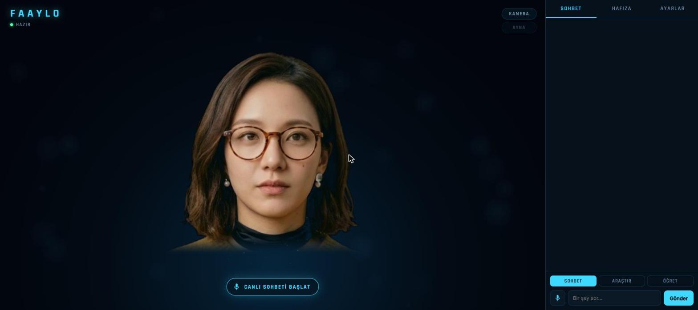

# 🪩 Faaylo — Conversational Digital Human

> A real‑time, lifelike **AI persona** that runs entirely on your own computer — it sees you, talks with you, and remembers you.

Faaylo is a personal AI you **talk to out loud**. It renders a photorealistic face as a hologram, speaks with a natural voice, watches you through the camera, and builds its own memory of you over time — all running **locally and offline** on your machine.

> ℹ️ This is a **showcase repository** — documentation and screenshots only. The source code is private.

---

## ✨ What it does

### 🗣️ Live voice conversation
- Press one button and just talk — Faaylo detects when you've stopped speaking and replies on its own.
- Interrupt it mid‑sentence and it stops and listens.
- Replies stream sentence by sentence and are spoken aloud (≈1–2s to start).

### 🙂 Holographic face with lip‑sync
- A lifelike face rendered in **WebGL** with a subtle breathing motion.
- **Wav2Lip** drives the mouth in sync with the generated speech.
- Upload a short clip or record from the webcam for an even more lifelike avatar.

### 📷 Camera awareness (fully local)
- Senses whether you're in front of the screen, smiling, or looking at it — and uses that in the conversation.
- **Mirror mode:** the hologram copies your head movements; otherwise it looks toward you.
- Face tracking runs locally in the browser (**MediaPipe**) — **your video never leaves the device.**

### 🧠 Memory & learning
- Extracts and stores facts about you from conversation (name, work, preferences).
- **Teach** mode saves exactly what you type; **Research** mode searches the web, saves what it reads, then answers.
- Semantic search over everything it has learned; review and delete memories anytime.

---

## 🛠️ Tech stack
**FastAPI** (decision engine, memory, research, voice) · **WebGL** hologram · **Wav2Lip** lip‑sync (Python 3.11, CUDA) · **MediaPipe** local face tracking · local LLMs via **Ollama** · **Piper** / **edge‑tts** voices.

---

## 👤 Author
Built by **Mehmet Faruk Aydın** — [@mefaay](https://github.com/mefaay) · Software Developer & Tech Lead, Nicosia (N. Cyprus).
